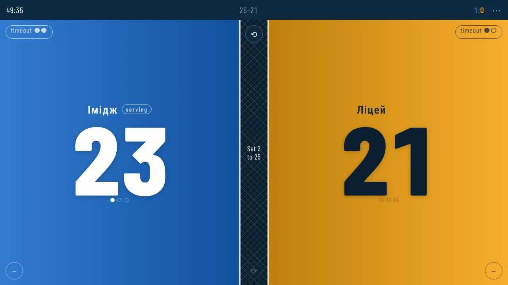
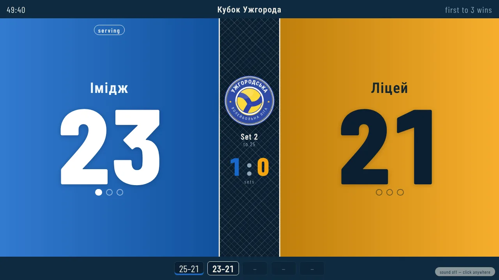
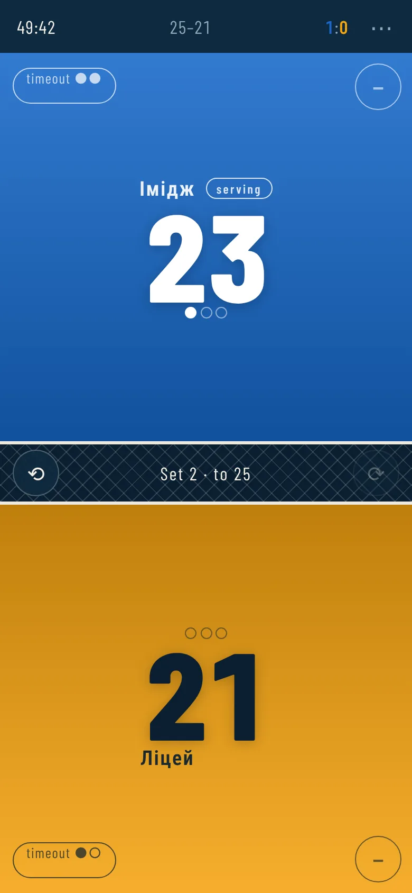
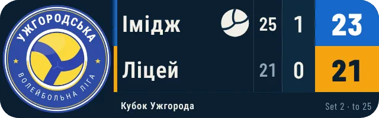
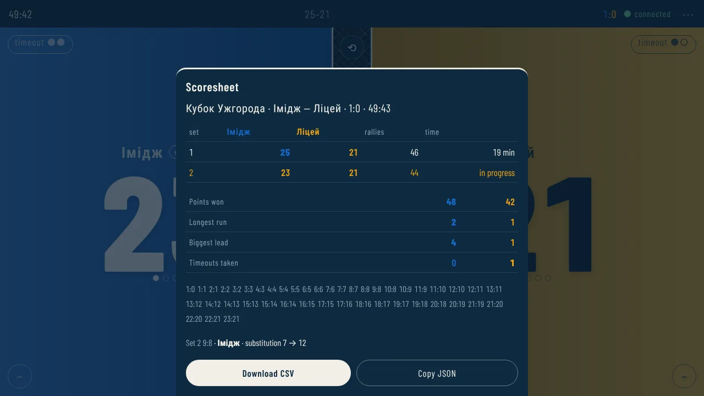
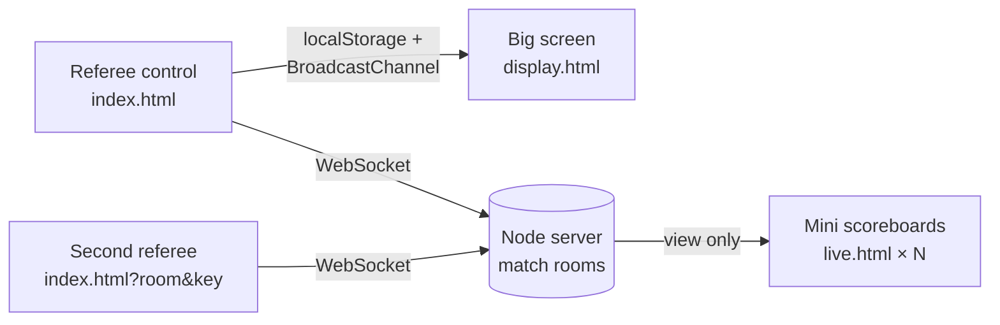

# Volleyball Scoreboard

[](https://github.com/VMMNick/volleyball_scoreboard/actions/workflows/deploy.yml)
[](LICENSE)

A referee's scoreboard for volleyball matches: a control on the phone, a big screen for the gym,
a mini scoreboard for live streams — synced in real time, working offline, in Ukrainian and English.

**Live demo:** <https://volleyball-scoreboard.onrender.com> (free tier — the first load may take up to a minute)
· **Українською:** [README.uk.md](README.uk.md) · **Referee guide (UA):** [docs/INSTRUCTION.md](docs/INSTRUCTION.md)

| Referee control | Spectator screen |
|---|---|
|  |  |

| Phone | Stream overlay | Scoresheet |
|---|---|---|
|  |  |  |

## What it does

- **Scoring built for a gym floor.** Tap a half of the screen to score. Sets, deciding set,
  point cap, serve rotation, timeouts with a countdown, substitutions (6 per set) and cards
  (a red card gives the opponent a point and the serve). Presets: indoor, beach, school.
  Beach mode has one timeout per set, no substitutions, a one-tap "switch sides" button every
  7 points (5 in the deciding set) and the technical timeout at 21.
- **Undo anything.** The whole match history, not just the last point; remove the last point of
  a specific team even after the opponent scored; reopen a finished match.
- **Big screen for spectators.** Projector or TV, arena or strip layout, set banners, timeout
  countdown, sounds synthesised with Web Audio — synced from the control on the same device
  without a server (`BroadcastChannel` + `storage` events).
- **Match link.** One click gives a view-only mini scoreboard for any phone, TV or streaming app
  (Prism Live, OBS) and a separate link for the second referee to keep score from another phone.
- **Scoresheet and archive.** Per-set score and duration, rally trail, stats, CSV/JSON export;
  the last 30 matches are kept on the device with their full scoresheets and can be searched by
  team, tournament, date or score.
- **Offline-first PWA.** Installs on a phone or tablet, keeps the score across reloads, keeps
  the screen awake.
- **Ukrainian and English.** Switch in settings; spectators' boards accept `?lang=en`.

## How it works



The site is plain HTML/CSS/JS with no framework and no build step; the same modules run in the
browser and in Node, so the rules and the sync logic are tested without a browser.
The server is ~400 lines on top of `ws`: it serves `public/` and keeps match rooms in memory.

## Engineering highlights

- **Event-sourced match.** A match is a list of events (`point`, `timeout`, `sub`, `card`, …);
  the state is always recomputed by a pure `reduce`. Undo/redo, the scoresheet, statistics and
  sync come out of that for free.
- **Two referees without lost points.** Every event has an id; undo and removal are tombstones.
  `Match.merge` unions both devices' events (ordered by time, ties by id) and is idempotent and
  commutative, so the server and every client converge. A Lamport-style clock never falls behind
  any time it has seen, so phones with skewed clocks still order new events correctly.
  `syncKey` compares content only, so converged devices stop talking — no ping-pong.
  A state from an older cached client (no ids) is never merged, to avoid double-counting during a rollout.
- **Rooms survive a server restart.** On a free host the process restarts and memory is gone.
  The server hands each control an HMAC-signed proof of ownership (`ROOM_SECRET`); after a restart
  the oldest valid proof wins the room back and an impostor who grabbed it is kicked.
  The second referee has a separate, rotatable key with its own proof tied to the owner's session.
- **A hosting quirk, found on production.** Render's proxy drops WebSocket close codes (the browser
  only sees `1006` after ~20 s), so rejections arrive as an explicit `{type:"error"}` message and
  clients say `{type:"bye"}` when leaving.
- **Hardened server.** The same `Match.validate` the browser uses rejects malformed events before
  they reach spectators; per-IP connection and room-creation limits; rooms opened only by viewers
  are freed immediately.
- **Cache version = content hash.** `npm run build` stamps the service worker with a hash of every
  cached file, so installed apps always update and nobody has to bump a version by hand.
- **Translation without touching the logic.** `i18n.js` translates the rendered page (and
  everything added later via `MutationObserver`, before paint), including phrases with numbers
  and team names; team names themselves stay untouched (`translate="no"`).

## Tests

```bash
npm test                          # ~240 unit and DOM tests (node:test + jsdom), ~15 s
npx playwright install chromium   # once
npm run e2e                       # 14 end-to-end scenarios in real Chromium, ~25 s
```

The end-to-end suite starts a real server and opens every device in its own browser context:
a spectator follows the score live; a second referee scores from another "phone";
**the server restarts mid-match** while an impostor grabs the room; **both referees keep scoring
while the server is down** and no point is lost after reconnecting; an undo made offline does not
come back; rotating the referee key disconnects the old referee; a finished match lands in the
archive and can be found by search; a full beach match with side switches and the technical timeout;
the whole match is played in English with no Ukrainian text left on any page.
GitHub Actions runs both suites on every push.

## Run locally

```bash
npm install
npm start          # http://localhost:3000 — the site plus the match-link server
```

Requires Node 20+. Opening `public/index.html` directly also works, without offline cache and match links.

## Deploy

**Render** — `render.yaml` is a ready Blueprint: Dashboard → New → Blueprint → this repository.
It creates a Node web service with a generated `ROOM_SECRET`; `/healthz` is the health check.

**GitHub Pages** (optional) — `.github/workflows/pages.yml` publishes `public/`; set the repository
variable `SYNC_SERVER` to the Render URL so match links go through the server.

## Project structure

```
public/            the site, served as is
  index.html       referee control        display.html   spectator screen
  live.html        mini scoreboard        mini.html      compact control
  js/core/         match.js (rules, merge, validation), palettes.js — no DOM
  js/shared/       remote (WebSocket), link, archive, i18n, feed, scorebug, sounds
  js/pages/        one script per page
server/server.js   static files + WebSocket rooms, ownership proofs, limits
scripts/build.js   checks the offline cache and stamps its version
tests/             unit and DOM tests; tests/e2e — Playwright
docs/              ARCHITECTURE, TESTING, INSTRUCTION (referee guide)
```

Details, data flow and "where does new code go": [docs/ARCHITECTURE.md](docs/ARCHITECTURE.md) (Ukrainian).

## License

[MIT](LICENSE)
