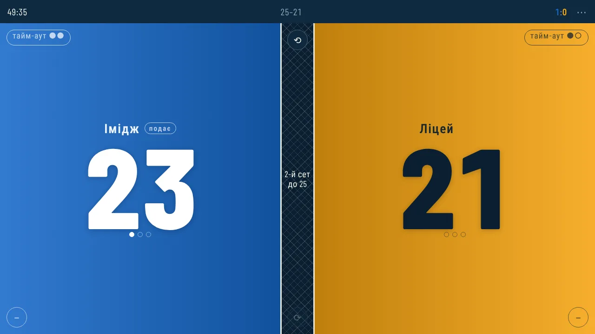
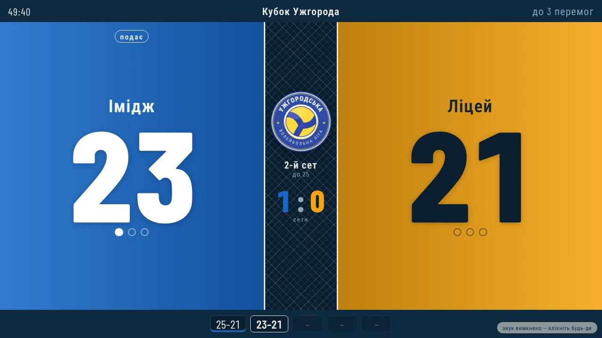
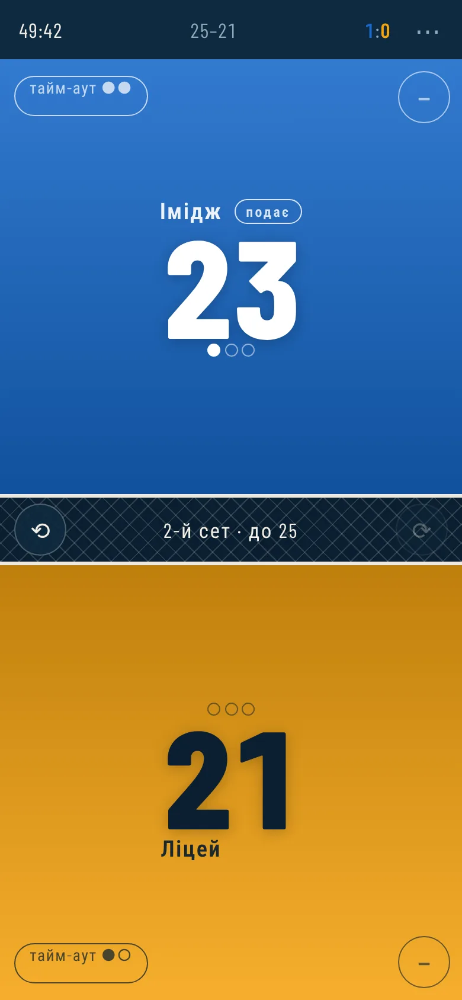
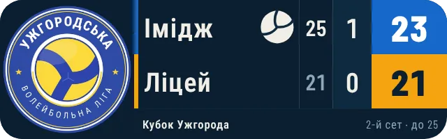
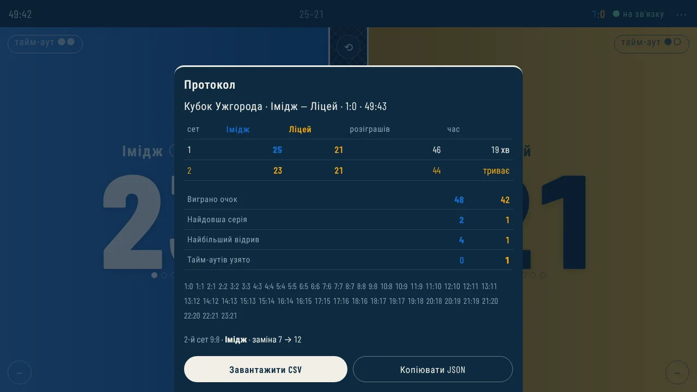

# Табло — волейбол

[](https://github.com/VMMNick/volleyball_scoreboard/actions/workflows/deploy.yml)

Лічильник рахунку для волейбольних матчів. Веде очки, сети, подачу, тайм-аути й протокол,
працює офлайн і ставиться на телефон чи планшет як застосунок. Без збірки — статика,
яку можна покласти на будь-який хостинг. Українською й англійською.

**Як користуватися — [docs/INSTRUCTION.md](docs/INSTRUCTION.md)** (покрокова інструкція для суддів).
· **Демо:** <https://volleyball-scoreboard.onrender.com> · **English:** [README.md](README.md)

| Пульт судді | Табло для глядачів |
|---|---|
|  |  |

| Телефон | Міні-табло для стріму | Протокол |
|---|---|---|
|  |  |  |

## Можливості

**Рахунок**
- Тап по половині екрана — очко команді. Половини великі, щоб влучати не дивлячись.
- Сети: 25 очок, різниця у два, вирішальний до 15. Формат — один сет, до двох
  або до трьох перемог. Опційна стеля очок (27 — і рахунок 27:26 уже дає перемогу).
- Подача переходить сама; при переході коротко зʼявляється «ротація».
  Першого подавача можна задати вручну на початку сету.
- Підказки в сітці: сетбол, матчбол, нагадування про зміну сторін на 8 очках у вирішальному.

**Виправлення помилок**
- Скасування й повтор будь-якої дії — уся історія матчу, а не лише останнє очко.
- Кнопка «−» знімає останній розіграш саме цієї команди, навіть якщо після нього
  суперник уже набрав свої.
- Помилкове останнє очко можна зняти навіть після кінця матчу — табло повернеться в гру.

**Заміни й картки**
- Меню → «Заміни й картки»: заміна за номерами (до 6 на команду в сеті),
  картки жовта / червона / вилучення / дискваліфікація — гравцю чи команді.
- Червона картка — штраф: очко й подача суперникові. Скасовується, як і все, кнопкою ⟲.
- Табло показує банер заміни й картки, протокол і CSV містять журнал.

**Правила**
- Пресети: **зала** (до 3 перемог, 25/15, зміна сторін на 8 у вирішальному),
  **пляж** (до 2 перемог, 21/15, один тайм-аут, зміна сторін кожні 7 очок,
  у вирішальному — кожні 5), **шкільний** (до 2 перемог, 25/15).
- Пресет лише заповнює поля — числа можна підправити вручну.

**Матч**
- Тайм-аути: по два на команду в сеті, з відліком 30 секунд на весь екран.
- Годинник матчу в шапці, тривалість кожного сету — у протоколі.
- Зміна сторін між сетами: рахунок їде за командами, не за половинами екрана.

**Протокол**
- Рахунок і тривалість по сетах, перебіг поточного сету по очках.
- Статистика: виграні очки, найдовша серія, найбільший відрив, узяті тайм-аути.
- Вивантаження CSV і копіювання JSON.

**Кольори**
- Половини залиті кольорами команд на весь екран — видно з іншого кінця залу,
  кому належить рахунок, навіть якщо не читати назви.
- Чотири палітри під форму команд: синій/бурштин, червоний/бірюза, фіолет/лайм,
  малина/трава. Колір змінюється одразу при виборі, а закриття налаштувань
  без збереження відкочує його назад.
- Колір тексту прорахований під кожен фон, щоб цифри лишались контрастними.
- Протокол, сети в шапці та підпис переможця пофарбовані в ті самі кольори.

**Дрібниці, які видно в залі**
- Рахунок переживає перезавантаження і закриття вкладки.
- Екран не гасне під час матчу (Screen Wake Lock).
- Вібрація на очко, окремий сигнал на кінець сету й матчу — вимикається в налаштуваннях.
- Повний екран для планшета на штативі чи проєктора.

**Табло для глядачів**
- Окрема сторінка `display.html` — лише показ, без кнопок. Відкривається з меню
  пульта («Табло для глядачів») в окремому вікні, яке перетягується на проєктор,
  ТБ чи другий монітор.
- Оновлюється наживо з пульта на цьому ж пристрої — без сервера й інтернету:
  стан іде через `localStorage` (подія `storage`) і `BroadcastChannel`.
- Два макети: **арена** — великі очки в кольорах команд, рахунок у сетах, історія
  сетів, сетбол/матчбол; **смуга** — компактний рядок для кута екрана чи стріму.
- Тайм-аут із відліком і переможець на весь екран — синхронно з пультом.
- Подвійний клік або `F` — повний екран, `L` — змінити макет. Курсор і підказка
  ховаються за 3 секунди. Екран не гасне.
- Адреса задає макет: `display.html?layout=arena` / `?layout=strip`.
- Назва турніру чи матчу з налаштувань пульта — у шапці табло, у протоколі
  й в імені CSV-файлу.
- Подачу можна сховати з табло (налаштування → «Показувати подачу на табло»).
- Стиль, шрифт і палітри ті самі, що на пульті (`css/theme.css` і `js/core/palettes.js` спільні).
- Встановлений застосунок має ярлики «Табло» і «Смуга» — довге натискання на іконку.
- Якщо підключено проєктор чи другий монітор, пульт відкриває табло одразу на ньому
  (Window Management API у Chrome/Edge; браузер один раз спитає дозвіл). Інакше —
  звичайне вікно, яке можна перетягнути.
- Звуки без аудіофайлів (Web Audio): свисток на тайм-аут, сигнал кінця тайм-ауту,
  сету й матчу. Браузер вмикає звук лише після кліку — табло про це підкаже.
  Вимикаються в налаштуваннях пульта.
- Анімації: спалах очка, «ротація» при переході подачі, банер «Сет виграла…» між
  сетами. З увімкненим «зменшенням руху» в системі анімації вимикаються.

**Міні-табло з керуванням (міні-пульт)**
- Меню → «Міні-табло з керуванням» відкриває маленьке окреме вікно `mini.html`:
  зверху міні-табло (назви команд, подача, сети, очки), під ним кнопки
  **+1 / −1** для кожної команди, **тайм-аут**, **⟲ Скасувати / ⟳ Повторити** і
  вибір першого подавача.
- Веде той самий матч, що й основний пульт: очко з будь-якого з них одразу видно
  в іншому, на великому табло й — якщо створено «Посилання на матч» — у другого
  судді та на міні-табло глядачів.
- Зручно тримати поруч з іншою програмою чи в окремій вкладці телефона. Клавіші:
  `1` / `2` — очко, `Q` / `P` — тайм-аут, `Backspace` — скасувати.
- Заміни, картки, налаштування й протокол — в основному пульті (посилання
  «Повний пульт ↗» внизу).
- **Табло й керування можна розвести по різних вікнах чи екранах**, і вони лишаються
  звʼязаними:
  - «Табло окремо ↗» у міні-пульті або «Міні-табло окремо» в меню пульта — лише
    міні-табло (`live.html`) у своєму вікні;
  - «Сховати табло» (або `mini.html?view=controls`) — лише кнопки, з рахунком у
    картках команд; вибір запамʼятовується;
  - на окремому табло є «Керування ↗» — відкриває кнопки того ж матчу (лише на цьому
    ж пристрої: у глядачів за посиланням на матч його немає).

**Міні-табло для інших додатків і сайтів**
- `live.html?room=…` — лише назви команд і лічильник; усі розміри рахуються від розміру
  таблиці, тож її можна вставити будь-куди й масштабувати.
- За замовчуванням — маленька таблиця (30 % ширини), решта прозора; з `&fit=fill` — на все вікно; в `<iframe>`
  або з `&fit=keep` — тримає пропорції 3,2 : 1, а поля довкола прозорі.
- «Код для вставки» в пульті й міні-пульті копіює готовий `<iframe>`
  (`Remote.embedCode`). Детально — [INSTRUCTION.md](INSTRUCTION.md#міні-табло-в-іншому-додатку-чи-на-сайті).
- Макет задає адреса: типово — назви й очки; `&layout=sets` додає колонку виграних сетів;
  `&layout=bug` — один рядок (назви по краях, очки до центру, рахунок за сетами посередині);
  `&layout=table` — як у волейбольних таблицях: рахунок кожного сету окремою колонкою;
  `&title=1` — смуга з назвою турніру. Вигляд обирається в пульті («Посилання на матч» →
  кнопки під «Розмір») і пишеться в адресу, а не в матч: одна кімната може світитися
  смугою в стрімі й табло з сетами в глядачів. Пропорції таблиці для кожного макета —
  `--ratio` у `css/pages/live.css` і `RATIO` у `js/pages/live.js` (однакові числа).
- **Чіткість у стрім-додатках.** Сторінка малюється в розмірі віджета, тож при 30 % ширини
  таблиця отримує ≈ втричі менше пікселів, ніж могла б, а додаток потім розтягує кадр. Прапорець
  «На весь віджет» у пульті додає `&fit=fill`: табло займає всю сторінку, а зменшує його вже сам
  віджет. Відсотки (`boardPct`) у цьому режимі не діють, кнопки − / + вимикаються.

**Міні-табло одразу маленьке**
- `live.html?room=…` за замовчуванням — лише маленька таблиця (30 % ширини екрана),
  поля прозорі: у будь-якому додатку, зокрема в Prism Live на телефоні, табло невелике
  без зменшування віджета.
- Ширина (10–100 %) — кнопками − / + у пульті чи міні-пульті; летить через сервер
  (`boardPct` у налаштуваннях) і змінюється просто під час ефіру. Адреса може її
  зафіксувати: `&size=20`. Інші режими: `&fit=fill` (на все вікно), `&fit=keep` / `<iframe>`.

**Посилання на матч**
- Меню → «Посилання на матч» → «Створити посилання». Пульт дає два посилання:
  - **Міні-табло** `live.html?room=…` — назви команд, хто подає, і лічильник.
    Відкривається на будь-якому телефоні, ТБ чи в іншому додатку, лише перегляд.
  - **Пульт для другого судді** `index.html?room=…&key=…` — той самий матч з іншого
    телефона: очки, тайм-аути, заміни, картки, скасування.
- **Два судді без втрат.** Пульти зливають стани подія за подією: очки, набрані на будь-якому
  з них без звʼязку, після перепідключення є в обох, а скасоване на одному не воскресає.
- **Окремий ключ судді.** У посиланні судді свій ключ, а не ключ власника. Кнопка «Новий ключ
  судді» одразу відключає старе посилання; міні-табло глядачів не змінюється. Суддя рахує,
  але не змінює налаштувань показу.
- У посиланні на міні-табло ключа судді немає — змінювати рахунок за ним неможливо.
  Посилання для судді надсилайте лише судді.
- Зник інтернет чи перезапустився сервер — усі перепідключаються самі й надсилають свій
  стан. Після рестарту сервера кімната повертається саме своєму судді (підписаний доказ
  власності), навіть якщо її встиг зайняти хтось інший. Посилання переживають перезавантаження.
- Потрібен сервер (`server/server.js`, див. «Деплой»). Без нього все працює як раніше:
  офлайн, на одному пристрої.

**Архів матчів**
- Меню → «Архів матчів»: до 30 останніх матчів на цьому пристрої — з рахунком, датою й назвою турніру.
- Матч потрапляє туди, коли закінчився, а також при «Новий матч», «Обнулити рахунок» і зміні формату.
- Для кожного — протокол і CSV, видалення й очищення архіву.

**Мова**
- Українська (типово) або англійська — у налаштуваннях пульта («Мова / Language»).
  Діє на всіх сторінках цього пристрою й запамʼятовується.
- Табло глядача на іншому пристрої — мовою з адреси: `live.html?room=…&lang=en`.
- Назви команд і турніру не перекладаються; підписи в CSV — мовою інтерфейсу.

## Пристрої

| Пристрій | Що показує |
|---|---|
| Телефон, портрет | Половини одна над одною, сітка поперек екрана |
| Телефон/планшет, альбом | Половини поруч, сітка вертикальна посередині |
| Планшет на штативі, ноутбук | Той самий альбомний розклад, цифри більші |
| Проєктор, ТБ у залі | Повний екран, розмір цифр тягнеться за висотою |

Розкладка перемикається за співвідношенням сторін (`min-aspect-ratio: 1/1`), а не за
шириною — планшет у портреті поводиться як великий телефон, а не як десктоп.
Розміри тексту й кнопок задані через `clamp()` у `vmin`, тож цифри лишаються
читабельними і на 5", і на 13".

## Керування

| Дія | Жест | Клавіатура |
|---|---|---|
| Очко | тап по половині | `1` / `2` |
| Тайм-аут | пігулка «тайм-аут» у куті | `Q` / `P` |
| Зняти очко | кружечок «−» у куті половини | — |
| Скасувати / повторити | `⟲` / `⟳` у сітці | `Backspace` / `Shift+Backspace` |
| Закрити вікно | тап повз вікно | `Esc` |
| Меню, протокол, налаштування | `⋯` у шапці | — |
| Кольори команд | налаштування → палітра | — |
| Свої кольори (команди, фон, рамка, текст таблиці) | налаштування → «Свої кольори» | — |

## Запуск

```bash
npm install            # ws для сервера посилань, jsdom і Playwright для тестів
npm start              # сервер: сайт з public/ + посилання на матч, http://localhost:3000
npm run build          # перевірка перед деплоєм: офлайн-кеш збігається з public/
```

Service worker і встановлення застосунку працюють лише з `https://` або `localhost`.
Просто відкритий `file://…/public/index.html` теж працює — без офлайн-кешу, встановлення й посилань на матч.

## Тести

```bash
npm test               # ~240 тестів (1 пропущено й 1 todo — пляжний волейбол відкладено)
npm run check          # синтаксис усіх скриптів
npx playwright install chromium   # один раз
npm run e2e            # 12 e2e-сценаріїв у справжньому Chromium
```

Набори (детально й чекліст ручної перевірки — у [docs/TESTING.md](docs/TESTING.md)):

- `tests/match.test.js` — правила: сети, баланс, вирішальний, тайм-аути, заміни, картки,
  скасування, статистика, протокол, CSV. Без залежностей.
- `tests/markup.test.js` — звʼязки між файлами: id, порядок скриптів, офлайн-кеш,
  шрифти, маніфест, збирання для хостингу. Без залежностей.
- `tests/ui.test.js` — справжні тапи на пульті в jsdom.
- `tests/display.test.js` — велике табло: синхронізація, банери, тайм-аут, фінал, звуки.
- `tests/mini.test.js` — міні-пульт: кнопки, синхронізація з пультом в обидва боки, пересилання на сервер.
- `tests/live.test.js` — міні-табло й «Посилання на матч»: другий суддя, синхронізація (фальшиві сокети).
- `tests/server.test.js` — сервер на справжніх сокетах: кімнати, ключ судді, глядачі,
  пізні підключення, сміття, статика, захист від `../`.
- `tests/flow.test.js` — повний матч 3:2 через інтерфейс пульта з підключеним табло.
- `tests/link.test.js`, `tests/archive.test.js`, `tests/i18n.test.js` — посилання на матч,
  архів і англійська версія без браузера.
- `tests/e2e/` — Playwright: справжній сервер і кілька «пристроїв» — глядач, другий суддя,
  рестарт сервера із самозванцем, обидва судді без звʼязку, новий ключ судді, архів, англійська.

Логіка матчу навмисно не знає про DOM — тому правила тестуються без браузера.

## Структура

Докладно, з потоками даних і правилами «що куди класти» — [docs/ARCHITECTURE.md](docs/ARCHITECTURE.md).

```
public/                     — САЙТ: усе, що отримує браузер (роздається як є, без збирання)
├── index.html              — пульт судді
├── display.html            — велике табло для глядачів (ТБ, проєктор)
├── live.html               — міні-табло: для стріму (Prism Live) і телефонів глядачів
├── mini.html               — міні-пульт: міні-табло + кнопки в окремому вікні
├── sw.js                   — офлайн-кеш (лежить у корені сайту, щоб діяти на всі сторінки)
├── js/config.js            — налаштування хостингу: адреса сервера посилань (для GitHub Pages)
├── manifest.webmanifest    — встановлення як застосунку
├── css/
│   ├── theme.css           — спільна тема: кольори, шрифти
│   ├── scorebug.css        — спільна таблиця міні-табла (live + mini)
│   └── pages/              — стилі кожної сторінки: pult, display, live, mini
├── js/
│   ├── core/               — ЯДРО без DOM (працює і в Node): match.js — правила, palettes.js — кольори
│   ├── shared/             — спільні модулі: ui-common, scorebug, remote, link, archive, i18n, feed, sounds
│   └── pages/              — логіка сторінок: pult.js, display.js, live.js, mini.js
└── assets/
    ├── fonts/              — Barlow Condensed + Roboto Condensed (OFL)
    ├── icons/              — іконки застосунку
    └── logos/              — емблеми ліги: uvl-new.webp, uvl-old.webp
server/server.js            — сервер: роздає public/ + WebSocket /ws (кімнати матчів)
scripts/build.js            — перевірка: кожен файл public/ є в офлайн-кеші й навпаки
scripts/pages-config.js     — вписує SYNC_SERVER у js/config.js під час деплою на GitHub Pages
tests/                      — node:test (+ helpers/site.js — де лежать файли); tests/e2e — Playwright
docs/                       — INSTRUCTION (для суддів), TESTING, ARCHITECTURE
render.yaml                 — деплой на Render
```

Матч зберігається як список подій (`point`, `timeout`, `swap`, `serve`, `sub`, `card`),
а стан завжди рахується з нуля. Звідси безкоштовно виходять скасування, повтор,
протокол і статистика. Посилання на матч передають той самий список подій — міні-табло
й другий пульт рахують стан тим самим ядром, а стани двох пультів зливаються подія за
подією (`Match.merge`).

## Деплой

Деплой — лише на Render. `render.yaml` уже в проєкті: Node-сервіс, який роздає табло
й тримає посилання на матч.

1. dashboard.render.com → **New** → **Blueprint** → репозиторій `volleyball_scoreboard` → **Apply**.
   Blueprint сам згенерує `ROOM_SECRET` — секрет для доказів власності кімнат.
2. Через 2–3 хвилини — `https://volleyball-scoreboard.onrender.com` (назва може відрізнятись).

Або вручну: **New** → **Web Service** (не Static Site!) → репозиторій, далі:

| Поле | Значення |
|---|---|
| Runtime | Node |
| Build Command | `npm install --omit=dev --no-audit --no-fund && npm run build` |
| Start Command | `npm start` |
| Health Check Path | `/healthz` |
| Environment | `ROOM_SECRET` — довгий випадковий рядок (напр. `node -e "console.log(require('crypto').randomBytes(32).toString('base64url'))"`); не змінюйте його потім |

Перевірка: `https://…onrender.com/healthz` має відповісти `{"ok":true,"rooms":0}`.
Якщо там «Not Found» — розгорнуто **Static Site**: сайт відкривається, але посилань на
матч і синхронізації між пристроями немає (пульт так і напише в поясненні «немає звʼязку»).

На безкоштовному плані сервіс засинає без відвідувачів і прокидається ~30–60 с.
Перед матчем відкрийте пульт заздалегідь — далі все працює без затримок.

### GitHub Pages

Сайт можна викласти й на GitHub Pages — `https://<користувач>.github.io/volleyball_scoreboard/`.
Workflow `.github/workflows/pages.yml` на кожен пуш у `main` проганяє тести й публікує папку `public/`.

1. GitHub → репозиторій → **Settings → Pages → Build and deployment → Source: GitHub Actions**.
2. **Settings → Secrets and variables → Actions → Variables → New repository variable**:
   `SYNC_SERVER` = адреса сервісу на Render (напр. `https://volleyball-scoreboard.onrender.com`).
3. Пуш у `main` (або **Actions → pages → Run workflow**). Адреса сайту — у підсумку запуску.

GitHub Pages віддає лише статичні файли, тому синхронізація між пристроями («Посилання на
матч») іде через сервер на Render: workflow вписує `SYNC_SERVER` у `public/js/config.js`.
Посилання для стріму й другого судді тоді ведуть на Render. Без `SYNC_SERVER` на Pages працює
все, крім посилань: пульт, велике табло й міні-табло на одному пристрої, офлайн, встановлення.

GitHub Actions (`.github/workflows/deploy.yml`) на кожен пуш перевіряє синтаксис, офлайн-кеш
й тести. Render деплоїть пуш у `main` сам.

Версію офлайн-кешу (`CACHE` у `public/sw.js`) вручну піднімати не треба: `npm run build`
рахує її з вмісту файлів і вписує сама, а Render і GitHub Pages запускають його перед кожним деплоєм.

## Далі

- Пляжний волейбол (технічний тайм-аут, тести) — відкладено.
- Пошук в архіві по командах і турнірах.

## Ліцензія

[MIT](LICENSE)
